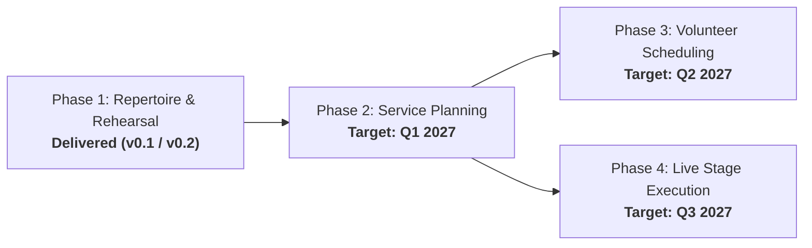

# WorshipFlow Strategic Product Roadmap

> [!NOTE]
> This roadmap documents the long-term engineering and capability trajectory of **WorshipFlow**. 
> As a church ministry platform, this project roadmap lives exclusively in project repository documentation, ensuring the production user interface remains clean, focused, and distraction-free for musicians, vocalists, and worship leaders.

---

## 1. Executive Summary & Horizons

| Phase                   | Strategic Objective                                                                                      | Target Horizon          | Status          |
| :---------------------- | :------------------------------------------------------------------------------------------------------- | :---------------------- | :-------------- |
| **Phase 1: Foundation** | Song repertoire catalog, multi-part vocal/instrument matrix, ChordPro transposer, and rehearsal player.  | Delivered (v0.1 / v0.2) | **Completed**   |
| **Phase 2: Planning**   | Service setlist planning, song sequencing, key transition guidance, and liturgy timing.                  | Q1 2027                 | **In Progress** |
| **Phase 3: Rostering**  | Team member scheduling, position assignments, volunteer availability/blackouts, and automated reminders. | Q2 2027                 | Planned         |
| **Phase 4: Stage Mode** | Distraction-free live stage teleprompter, Bluetooth pedal navigation, and presentation software sync.    | Q3 2027                 | Planned         |

---

## 2. Phase 1 — Repertoire & Rehearsal Foundation (Delivered)

### Milestone 1.1: Song Repertoire & Arrangement Catalog

_Centralized song repository storing lyrics, ChordPro charts, canonical keys, tempo, and liturgical tags._

- **cap-1-1 · Song Catalog CRUD with Canonical Keys** `[P1 · Repertoire]`
  - _Persona_: Worship Leader
  - _Acceptance Criteria_: Songs created and edited with 24 canonical keys, BPM, time signature, and ChordPro charts.
- **cap-1-2 · Custom Repertoire Tags & Service Labels** `[P2 · Repertoire]`
  - _Persona_: Worship Leader
  - _Acceptance Criteria_: Color-coded labels (`Sunday Set`, `Communion`, `Youth`, `Christmas`) to filter repertoire.
- **cap-1-3 · Multi-Format Lyrics & Chord Editor** `[P3 · Repertoire]`
  - _Persona_: Band Member
  - _Acceptance Criteria_: Inline ChordPro syntax editing with live preview and key transpositions.

### Milestone 1.2: Multi-Voice Rehearsal & Readiness Tracking

_Part assignments, vocal harmonies, section timestamp markers, and synchronized rehearsal player._

- **cap-1-4 · Multi-Voice Vocal & Instrument Assignments** `[P1 · Rehearsal]`
  - _Persona_: Vocalist / Musician
  - _Acceptance Criteria_: Assign lead vocals, harmonies (2ª/3ª voz), and instruments per song with technical notes.
- **cap-1-5 · Practice Status Tracking & Readiness Indicator** `[P2 · Rehearsal]`
  - _Persona_: Worship Leader
  - _Acceptance Criteria_: Volunteers toggle preparation status: _Pendiente_, _Ensayando parte_, or _Lista para servicio_.
- **cap-1-6 · YouTube Video Playback & Timestamp Section Sync** `[P2 · Rehearsal]`
  - _Persona_: Musician
  - _Acceptance Criteria_: A-B loop rehearsal, speed adjustments, and instant seek to song sections (Verse, Chorus, Bridge).

---

## 3. Phase 2 — Service Planning & Setlist Management (Q1 2027)

### Milestone 2.1: Setlist Sequencing & Service Timing

_Prerequisite_: Milestone 1.1 (Repertoire Catalog)

- **cap-2-1 · Drag-and-Drop Song Ordering in Setlists** `[P1 · Planning]`
  - _Persona_: Worship Leader
  - _Acceptance Criteria_: Drag-and-drop song arrangement order for specific dates with dynamic total runtime calculation.
- **cap-2-2 · Key Transition & BPM Flow Guidance** `[P2 · Planning]`
  - _Persona_: Music Director
  - _Acceptance Criteria_: Visual harmonic wheel guidance preventing jarring vocal leaps between consecutive songs.
- **cap-2-3 · Service Duration & Item Timing Calculator** `[P2 · Planning]`
  - _Persona_: Service Coordinator
  - _Acceptance Criteria_: Real-time duration summation adjusting automatically when songs or items are rearranged.

### Milestone 2.2: Liturgy & Order of Service Elements

- **cap-2-4 · Custom Liturgical & Non-Musical Service Items** `[P1 · Planning]`
  - _Persona_: Pastor
  - _Acceptance Criteria_: Add prayers, scripture readings, sermon notes, and welcomes directly into setlists.
- **cap-2-5 · Reusable Service Order Templates** `[P2 · Planning]`
  - _Persona_: Worship Leader
  - _Acceptance Criteria_: Save standard Sunday morning or midweek liturgy structures as reusable templates.
- **cap-2-6 · Leader Service Notes & Pastoral Cues** `[P3 · Planning]`
  - _Persona_: Pastor / Coordinator
  - _Acceptance Criteria_: Private stage coordinator notes for vocal cues and prayer transitions.

---

## 4. Phase 3 — Volunteer Scheduling & Roster Management (Q2 2027)

### Milestone 3.1: Volunteer Position Scheduling & Invitations

_Prerequisite_: Milestone 2.1 (Setlist Sequencing)

- **cap-3-1 · Volunteer Position Rostering & Scheduling** `[P1 · Rostering]`
  - _Persona_: Worship Coordinator
  - _Acceptance Criteria_: Schedule vocalists, band musicians, and AV tech operators to upcoming service dates.
- **cap-3-2 · Team Invitation & Email Confirmation Flow** `[P2 · Rostering]`
  - _Persona_: Volunteer
  - _Acceptance Criteria_: Automated dispatch with one-click Accept/Decline action links.
- **cap-3-3 · Ministry Position Coverage Matrix** `[P2 · Rostering]`
  - _Persona_: Worship Leader
  - _Acceptance Criteria_: Real-time grid highlighting unfilled instrumental or technical roles.

### Milestone 3.2: Volunteer Availability & Block-out Dates

- **cap-3-4 · Volunteer Block-out Dates Management** `[P1 · Rostering]`
  - _Persona_: Volunteer
  - _Acceptance Criteria_: Self-service availability portal allowing team members to submit blackout dates.
- **cap-3-5 · Scheduling Conflict Detection** `[P2 · Rostering]`
  - _Persona_: Worship Coordinator
  - _Acceptance Criteria_: Automated alerts when volunteers are scheduled across conflicting teams on the same day.
- **cap-3-6 · Automated Rehearsal & Service Reminders** `[P3 · Rostering]`
  - _Persona_: Volunteer
  - _Acceptance Criteria_: Scheduled reminder notifications dispatched 48h and 2h prior to rehearsal call.

---

## 5. Phase 4 — Live Service Execution & Stage Mode (Q3 2027)

### Milestone 4.1: Live Stage Teleprompter & Chord Charts

_Prerequisites_: Milestone 1.1 (Repertoire) & Milestone 2.1 (Setlists)

- **cap-4-1 · High-Contrast Live Teleprompter Stage View** `[P1 · Stage]`
  - _Persona_: Band Member / Singer
  - _Acceptance Criteria_: Distraction-free, dark-mode, large-type chord and lyric teleprompter designed for low-light stage tablets.
- **cap-4-2 · Instant Chart Transposition & Capo Display** `[P1 · Stage]`
  - _Persona_: Musician
  - _Acceptance Criteria_: Instant transposition between team practice keys, original keys, and acoustic guitar capo chords.
- **cap-4-3 · Hands-Free Bluetooth Pedal Navigation** `[P3 · Stage]`
  - _Persona_: Guitarist / Keyboardist
  - _Acceptance Criteria_: PageUp / PageDown hardware pedal integration for foot-triggered section jumping.

### Milestone 4.2: Live Cues & Presentation Software Integration

- **cap-4-4 · Presentation Software Slide Export (ProPresenter)** `[P2 · Stage]`
  - _Persona_: AV Tech
  - _Acceptance Criteria_: Export service lyrics directly into standard formats used by church projection systems.
- **cap-4-5 · Synchronized Live Band Section Cues** `[P3 · Stage]`
  - _Persona_: Music Director
  - _Acceptance Criteria_: Band leader section cues ("Chorus", "Bridge", "Down") broadcast to musicians' stage monitors.

---

## 6. Functional Track & Priority Matrix

| Track          | P1 (Must-Have)                            | P2 (High Priority)                          | P3 (Medium Priority)                         |
| :------------- | :---------------------------------------- | :------------------------------------------ | :------------------------------------------- |
| **REPERTOIRE** | Catalog CRUD with canonical keys          | Liturgical season tags                      | ChordPro syntax editor                       |
| **REHEARSAL**  | Multi-part vocal/instrument matrix        | Status readiness indicator, Video sync      | Advanced loop intervals                      |
| **PLANNING**   | Drag-drop song ordering, Service liturgy  | Duration calculator, Harmonic wheel flow    | Pastoral cues & notes                        |
| **ROSTERING**  | Volunteer position rostering, Blackouts   | Email confirmation flow, Conflict detection | Automated call reminders                     |
| **STAGE**      | High-contrast teleprompter, Transposition | ProPresenter slide export                   | Bluetooth pedal foot control, Live band cues |

---

## 7. Architectural Alignment

All capabilities adhere strictly to WorshipFlow's 4-layer Clean Architecture:
- **Core Domain**: Entities, value objects (canonical keys, chords, time signatures), and pure business rules.
- **Core Application**: Use cases and repository interfaces (`ports.ts`, DTOs, schemas).
- **Infrastructure**: D1 / SQLite persistence, Cloudflare Workers runtime shims, third-party adapters.
- **Presentation**: UI components built with Tailwind CSS tokens and strict accessibility (`min-h-[44px]`, ARIA).
