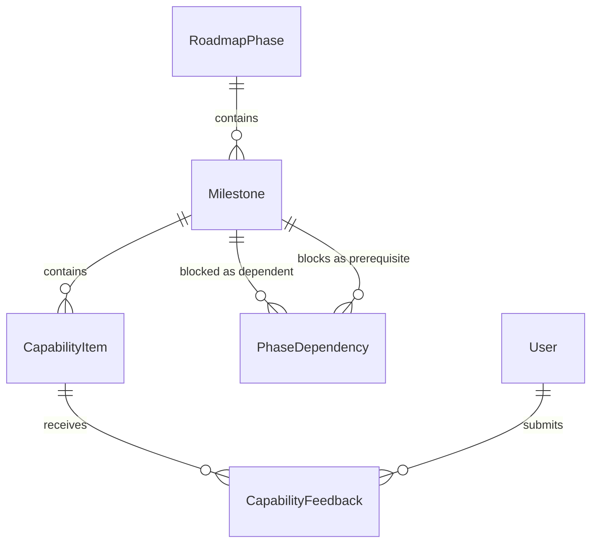
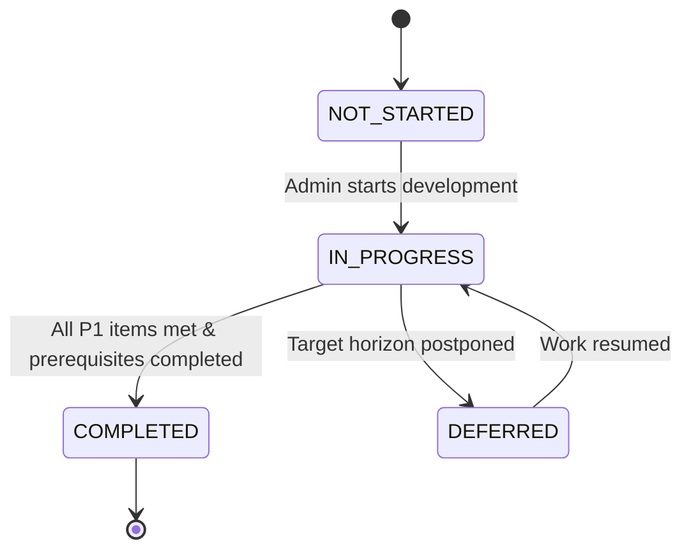

# Data Model: WorshipFlow Product Roadmap

**Feature**: WorshipFlow Product Roadmap (Milestones, Priorities, and Dependency Phases)  
**Branch**: `001-product-roadmap`  
**Date**: 2026-11-10

This document specifies the domain entities, relationships, validation constraints, and lifecycle state transitions for the WorshipFlow Product Roadmap.

---

## 1. Domain Entities & Value Objects

### 1.1 Enumerations & Value Objects

#### `PhaseStatus`

Represents the operational status of a roadmap phase:
- `PLANNED`: Phase is defined but work has not yet begun.
- `IN_PROGRESS`: Active development underway across one or more milestones.
- `COMPLETED`: All critical milestones and capabilities within the phase are delivered.
- `PENDING_PREREQUISITES`: Phase is blocked by incomplete upstream prerequisite phases.

#### `MilestoneStatus`

Represents the delivery status of a cohesive milestone:
- `NOT_STARTED`: Work has not commenced.
- `IN_PROGRESS`: Milestone deliverables are currently being built or verified.
- `COMPLETED`: All acceptance criteria for the milestone have been met.
- `DEFERRED`: Milestone completion timeline has been shifted to a later horizon.

#### `PriorityTier`

Represents the ministry importance of a capability:
- `P1`: Critical MVP (Essential for core operational viability).
- `P2`: High Priority (Major enhancement to workflow efficiency).
- `P3`: Medium Priority (Value-add capability).
- `P4`: Future Enhancement (Optional polish or long-term integration).

#### `FunctionalTrack`

Categorizes capabilities by ministry operational domain:
- `REPERTOIRE`: Song catalog, arrangement keys, BPM, lyrics, chord charts.
- `PLANNING`: Service order of service, setlist sequencing, liturgy items.
- `ROSTERING`: Volunteer positions, availability, invitations, scheduling.
- `REHEARSAL`: Multi-part vocal/instrument practice matrix, YouTube sync, readiness tracking.
- `STAGE`: Live teleprompter, live chord presentation, live section cues, presentation exports.

---

### 1.2 Core Entities

#### `RoadmapPhase`

Represents a major strategic development era.

| Field           | Type          | Constraints                | Description                                                     |
| --------------- | ------------- | -------------------------- | --------------------------------------------------------------- |
| `id`            | `string`      | Primary Key, UUID / NanoID | Unique phase identifier                                         |
| `phaseNumber`   | `number`      | Integer, 1 to 4, Unique    | Sequential phase index (1, 2, 3, 4)                             |
| `name`          | `string`      | Not empty, max 100 chars   | Display title of the phase                                      |
| `description`   | `string`      | Text, max 500 chars        | Strategic ministry objective of the phase                       |
| `status`        | `PhaseStatus` | Enum                       | Current phase operational state                                 |
| `targetHorizon` | `string`      | Not empty, max 50 chars    | Target delivery timeframe (e.g., "Delivered (v0.1)", "Q1 2027") |
| `createdAt`     | `string`      | ISO 8601 DateTime          | Record creation timestamp                                       |
| `updatedAt`     | `string`      | ISO 8601 DateTime          | Last modification timestamp                                     |

#### `Milestone`

Represents a cohesive delivery goal within a phase.

| Field                  | Type              | Constraints                     | Description                                |
| ---------------------- | ----------------- | ------------------------------- | ------------------------------------------ |
| `id`                   | `string`          | Primary Key, UUID / NanoID      | Unique milestone identifier                |
| `phaseId`              | `string`          | Foreign Key → `RoadmapPhase.id` | Owning roadmap phase                       |
| `title`                | `string`          | Not empty, max 120 chars        | Name of the milestone                      |
| `description`          | `string`          | Text, max 1000 chars            | Detailed summary of capabilities delivered |
| `status`               | `MilestoneStatus` | Enum                            | Current delivery status                    |
| `sortOrder`            | `number`          | Integer >= 0                    | Display sequence within the phase          |
| `targetCompletionDate` | `string \| null`  | Optional YYYY-MM-DD             | Estimated completion target date           |
| `releaseNotes`         | `string \| null`  | Optional Text, max 2000 chars   | Stakeholder notes upon delivery            |
| `createdAt`            | `string`          | ISO 8601 DateTime               | Record creation timestamp                  |
| `updatedAt`            | `string`          | ISO 8601 DateTime               | Last modification timestamp                |

#### `CapabilityItem`

Represents a discrete feature deliverable belonging to a milestone.

| Field                | Type              | Constraints                  | Description                                              |
| -------------------- | ----------------- | ---------------------------- | -------------------------------------------------------- |
| `id`                 | `string`          | Primary Key, UUID / NanoID   | Unique capability identifier                             |
| `milestoneId`        | `string`          | Foreign Key → `Milestone.id` | Owning milestone                                         |
| `title`              | `string`          | Not empty, max 120 chars     | Clear feature capability title                           |
| `targetPersona`      | `string`          | Not empty, max 100 chars     | Ministry role served (e.g. "Worship Leader", "Vocalist") |
| `functionalTrack`    | `FunctionalTrack` | Enum                         | Ministry functional area                                 |
| `priorityTier`       | `PriorityTier`    | Enum                         | Priority level (P1-P4)                                   |
| `acceptanceCriteria` | `string`          | Text, max 1000 chars         | Verification outcome summary                             |
| `isCompleted`        | `boolean`         | Default `false`              | Whether deliverable has shipped                          |
| `sortOrder`          | `number`          | Integer >= 0                 | Ordering within milestone                                |
| `createdAt`          | `string`          | ISO 8601 DateTime            | Record creation timestamp                                |
| `updatedAt`          | `string`          | ISO 8601 DateTime            | Last modification timestamp                              |

#### `PhaseDependency`

Represents a directional prerequisite relationship between two milestones or phases.

| Field                     | Type      | Constraints                  | Description                                              |
| ------------------------- | --------- | ---------------------------- | -------------------------------------------------------- |
| `id`                      | `string`  | Primary Key, UUID / NanoID   | Unique dependency identifier                             |
| `dependentMilestoneId`    | `string`  | Foreign Key → `Milestone.id` | Milestone that is blocked                                |
| `prerequisiteMilestoneId` | `string`  | Foreign Key → `Milestone.id` | Milestone that must be completed first                   |
| `isBlocking`              | `boolean` | Default `true`               | Whether incomplete prerequisite blocks status completion |
| `createdAt`               | `string`  | ISO 8601 DateTime            | Timestamp link created                                   |

_Constraint_: Compound unique index on `(dependentMilestoneId, prerequisiteMilestoneId)`. Cyclic dependency validation enforced at application layer.

#### `CapabilityFeedback`

Represents a volunteer interest signal / vote on an upcoming capability.

| Field          | Type             | Constraints                       | Description                                   |
| -------------- | ---------------- | --------------------------------- | --------------------------------------------- |
| `id`           | `string`         | Primary Key, UUID / NanoID        | Unique feedback identifier                    |
| `capabilityId` | `string`         | Foreign Key → `CapabilityItem.id` | Associated roadmap capability                 |
| `userId`       | `string`         | Foreign Key → `User.id`           | Voting volunteer user                         |
| `hasInterest`  | `boolean`        | Default `true`                    | Active vote status (true = voted)             |
| `note`         | `string \| null` | Optional Text, max 280 chars      | Contextual volunteer note / ministry feedback |
| `createdAt`    | `string`         | ISO 8601 DateTime                 | Initial vote timestamp                        |
| `updatedAt`    | `string`         | ISO 8601 DateTime                 | Last note / toggle update timestamp           |

_Constraint_: Compound unique index on `(capabilityId, userId)`. Guarantees exactly one active vote toggle per user per capability.

---

## 2. Entity Relationships Diagram

---

## 3. Lifecycle State Machine & Validation Invariants

### 3.1 Milestone State Transitions

### 3.2 Domain Invariants (Business Rules)

1. **Prerequisite Gating**: A milestone CANNOT be transitioned to `COMPLETED` if any upstream milestone linked via `PhaseDependency` with `isBlocking = true` is not yet in `COMPLETED` state.
2. **Phase Completion Calculation**: A `RoadmapPhase` automatically reports `COMPLETED` only when 100% of its contained milestones are marked `COMPLETED`.
3. **Unique Vote Enforcement**: A user cannot cast multiple votes for a single capability. Submitting an interest toggle either inserts a new record or updates `hasInterest` and `note`.
4. **Note Length**: Volunteer notes submitted with an interest vote cannot exceed 280 characters.
5. **Phase Sequence Integrity**: Phase numbers are strictly 1, 2, 3, and 4; reordering phases requires updating the sequence order with no duplicate phase numbers.
