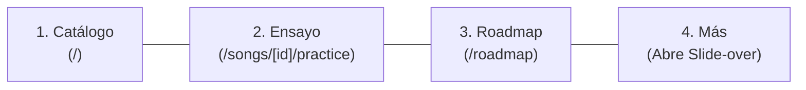

# UI Contract: Global App Shell & Mobile Navigation Architecture

**Feature**: WorshipFlow Design System & Page UI Architecture  
**Branch**: `002-design-system-ui`  
**Date**: 2026-11-10  
**Architect**: Rehearsal & Navigation Architect  
**Status**: Draft

---

## 1. Overview & Architecture Scope

The WorshipFlow **App Shell** provides the persistent layout skeleton across all 8 application routes. It defines the visual header, navigation routing, responsive viewport adaptations, edge theme persistence, and identity status.

### 1.1 Responsive Navigation Strategy

| Viewport Breakpoint                               | Primary Navigation Surface                                                                                        | Secondary / Administrative Surface                                                                |
| ------------------------------------------------- | ----------------------------------------------------------------------------------------------------------------- | ------------------------------------------------------------------------------------------------- |
| **Desktop / Tablet Landscape** (`≥768px` / `md+`) | Persistent Top Header Navbar (height: `64px` / `4rem`), horizontal menu with active route indicator.              | Dedicated Admin dropdown / menu and action buttons directly in header.                            |
| **Mobile / Tablet Portrait** (`<768px`)           | Fixed Bottom Navigation Dock (`h-16` + `safe-area-inset-bottom`), 4 ergonomic 1-thumb touch targets (`≥48x48px`). | "Más" Slide-Over Drawer / Sheet providing user profile, Admin consoles, theme switch, and logout. |

### 1.2 Layout Skeleton & Landmark Regions

```
+--------------------------------------------------------------------------+
|  <header> Top Navbar (Visible ≥768px, Compact on <768px)                |
|  [Logo & Pulsing Insignia] [Catálogo] [Roadmap] [Admin v] [Theme] [Avatar] |
+--------------------------------------------------------------------------+
|  <main id="main-content" class="min-h-screen pb-20 md:pb-8">             |
|                                                                          |
|  Route Content (Catalog, Detail, Practice, Form, Roadmap, Admin, etc.)   |
|                                                                          |
+--------------------------------------------------------------------------+
|  <nav id="mobile-dock" class="fixed bottom-0 block md:hidden z-50">      |
|  [ Catálogo ]       [ Ensayo ]       [ Roadmap ]       [ Más (Drawer) ]  |
+--------------------------------------------------------------------------+
|  <aside id="more-drawer" (Slide-over sheet when activated)>              |
|  [User Info & Role] [Admin Consoles] [Theme Toggle] [Logout]             |
+--------------------------------------------------------------------------+
```

---

## 2. Desktop Navigation Header (`Navbar`)

### 2.1 Placement & Visual Specification (≥768px)

- **Position**: Sticky top (`sticky top-0 z-40 w-full`).
- **Dimensions**: Height `64px` (`h-16`), horizontal padding `1.5rem` (`px-6`).
- **Surface**: `bg-background/80 backdrop-blur-md border-b border-border`.
- **Transitions**: CSS transition `border-color 200ms ease, background-color 200ms ease`.

### 2.2 Component Hierarchy

```
Navbar (Container)
├── BrandCluster (Left)
│   ├── WorshipFlowInsignia (Animated glow pulse on hover, 32x32px SVG icon)
│   ├── BrandTitle ("WorshipFlow", font-semibold, tracking-tight)
│   └── VersionBadge ("v0.2", text-xs, muted-foreground pill)
├── PrimaryNavLinks (Center/Left)
│   ├── NavItem href="/" ("Catálogo", IconMusic)
│   ├── NavItem href="/roadmap" ("Roadmap", IconMilestone)
│   ├── NavItem href="/songs/new" ("Nueva Canción", IconPlusCircle, gated to ADMIN/Leader)
│   └── AdminDropdownMenu (Gated to ADMIN)
│       ├── DropdownItem href="/admin/users" ("Usuarios", IconUsers)
│       └── DropdownItem href="/admin/labels" ("Etiquetas", IconTag)
└── UtilityCluster (Right)
    ├── ThemeToggle (Sun/Moon icon button, 36x36px)
    ├── UserProfileMenu
    │   ├── UserAvatar (36x36px rounded-full with initials or photo)
    │   ├── RoleBadge (Pill badge: ADMIN in Indigo, MEMBER in Slate)
    │   └── DropdownMenu (Perfil, Preferencias, Cerrar Sesión)
    └── LoginButton (Rendered when unauthenticated, redirects to `/login`)
```

### 2.3 Navigation Item Interactive States

- **Default**: `text-muted-foreground hover:text-foreground hover:bg-accent/50 rounded-md px-3 py-2 text-sm font-medium transition-colors`.
- **Active Route** (`aria-current="page"`): `text-foreground bg-accent/80 font-semibold shadow-xs`.
- **Focus Visible**: `focus-visible:outline-hidden focus-visible:ring-2 focus-visible:ring-ring focus-visible:ring-offset-2`.

---

## 3. Mobile Bottom Navigation Dock (`MobileDock`)

### 3.1 Ergonomics & Touch Target Sizing (<768px)

- **Position**: `fixed bottom-0 left-0 right-0 z-50`.
- **Dimensions**:
  - Height: `64px` (`h-16`) + padding for mobile safe area: `padding-bottom: env(safe-area-inset-bottom, 0px)`.
  - Content container: `max-w-md mx-auto grid grid-cols-4 h-full items-center`.
- **Surface**: `bg-background/90 backdrop-blur-lg border-t border-border shadow-lg`.
- **Touch Target**: Every dock button occupies `100%` height of dock with minimum width `64px` (`min-h-[48px] min-w-[48px]`), ensuring comfortable 1-thumb reach during rehearsals and stage use.

### 3.2 Mobile Dock Actions (4 Anchors)



1. **Catálogo (`/`)**:
   - Icon: `MusicNotes` (24x24px).
   - Label: "Catálogo" (text-[10px], font-medium).
   - Route Match: Active when `pathname === '/'` or `pathname.startsWith('/songs') && !pathname.includes('/practice')`.
2. **Ensayo (`/songs/[id]/practice`)**:
   - Icon: `PlayCircle` / `Mic` (24x24px).
   - Label: "Ensayo" (text-[10px], font-medium).
   - Route Match: Active when `pathname.includes('/practice')`.
   - Dynamic Target: Navigates to currently active practice song or the last practiced song cached in `localStorage('worshipflow_last_practice_song')`. If none, navigates to `/` with filter for practice ready.
3. **Roadmap (`/roadmap`)**:
   - Icon: `MapPin` / `Milestone` (24x24px).
   - Label: "Roadmap" (text-[10px], font-medium).
   - Route Match: Active when `pathname.startsWith('/roadmap')`.
4. **Más (Slide-Over Drawer Trigger)**:
   - Icon: User Avatar Thumbnail or `SlidersHorizontal` icon with unread badge if updates exist.
   - Label: "Más" (text-[10px], font-medium).
   - Action: Toggles `isDrawerOpen: true`.

### 3.3 Active Item Visual Indicator

- Active tab displays an elevated colored pill behind the icon (`bg-primary/15 text-primary`) and a subtle glowing top indicator dot (`w-1 h-1 rounded-full bg-primary mx-auto mt-0.5`).
- Inactive tabs render in `text-muted-foreground` and transition to `text-foreground` on tap.

---

## 4. "Más" Slide-Over Drawer (`MoreDrawer`)

### 4.1 Drawer Architecture & Modality (<768px)

- **Container**: Sliding sheet emerging from the bottom or right edge.
- **Overlay**: `fixed inset-0 bg-background/80 backdrop-blur-sm z-50 transition-opacity`.
- **Sheet Surface**: `fixed bottom-0 inset-x-0 z-50 rounded-t-2xl bg-card border-t border-border p-6 shadow-2xl max-h-[85vh] overflow-y-auto`.
- **Gesture Support**:
  - Pull-down drag bar indicator (`w-12 h-1.5 bg-muted-foreground/30 rounded-full mx-auto mb-4`).
  - Swiping down closes drawer.
  - Tapping backdrop or pressing `ESC` dismisses drawer immediately.

### 4.2 Drawer Content Sections

```
MoreDrawer (Container)
├── DragHandle (Centred pill)
├── UserProfileCard
│   ├── Avatar (48x48px with initials)
│   ├── UserDetails (Name, Email)
│   └── RoleBadge (ADMIN in Indigo / MEMBER in Slate)
├── NavigationGroup (Label: "Navegación Rápida")
│   ├── DrawerLink href="/songs/new" ("Nueva Canción", IconPlus)
│   └── DrawerLink href="/roadmap" ("Roadmap Estratégico", IconMilestone)
├── AdminGroup (Visible if session.role === 'ADMIN', Label: "Administración")
│   ├── DrawerLink href="/admin/users" ("Gestión de Usuarios", IconUsers)
│   └── DrawerLink href="/admin/labels" ("Etiquetas de Repertorio", IconTags)
├── PreferencesGroup (Label: "Preferencias")
│   └── ThemeSelectorRow (Dark / Light toggle with instant visual feedback)
└── SessionActionsGroup
    └── LogoutButton (Full-width outline button, destructive hover)
```

---

## 5. Theme Switcher Contract (`ThemeToggle`)

### 5.1 Zero-FOUC Edge SSR Persistence

To prevent Flash of Unstyled Content (FOUC) when loading on Cloudflare Workers edge runtime:
1. **Cookie Contract**: The client writes cookie `worshipflow_theme=dark` or `worshipflow_theme=light` with `Path=/; Max-Age=31536000; SameSite=Lax`.
2. **SSR Ingestion**: Root layout reads `request.headers.get('cookie')` on the edge server.
3. **HTML Class Injection**: The root `<html lang="es" className={resolvedTheme}>` receives the class immediately before hydration.
4. **Default Mode**: If no cookie is present, defaults strictly to `'dark'` (Dark-First Default for stage readiness).

### 5.2 Client Hook Interface (`useTheme`)

```typescript
export type ThemeMode = "dark" | "light";

export interface UseThemeReturn {
  theme: ThemeMode;
  resolvedTheme: ThemeMode;
  setTheme: (theme: ThemeMode) => void;
  toggleTheme: () => void;
  isDark: boolean;
}
```

### 5.3 Micro-Interaction & Accessibility

- **Animation**: The switch button features a spinning Sun/Moon icon using React Bits inspired CSS transitions:
  - Moon icon rotates 90° and fades out when transitioning to Light.
  - Sun icon scales up from 0.5 to 1.0 with subtle ray flare.
- **Accessibility Attributes**:
  - `role="switch"`
  - `aria-checked={theme === 'dark'}`
  - `aria-label="Alternar tema visual (actual: modo oscuro)"`
  - Keyboard trigger: `Space` or `Enter`.

---

## 6. Role Avatar Badges (`RoleBadge`)

### 6.1 Role Distinctions & Styling

| Role     | Badge Text | Background Token   | Text / Border Token                       | Icon                    | Accessibility Label                   |
| -------- | ---------- | ------------------ | ----------------------------------------- | ----------------------- | ------------------------------------- |
| `ADMIN`  | `ADMIN`    | `bg-indigo-500/15` | `text-indigo-400 border-indigo-500/30`    | `ShieldCheck` (12x12px) | "Rol: Administrador del sistema"      |
| `MEMBER` | `MIEMBRO`  | `bg-secondary`     | `text-secondary-foreground border-border` | `User` (12x12px)        | "Rol: Miembro del equipo de alabanza" |

### 6.2 Component Specification

```typescript
export interface RoleBadgeProps {
  role: "ADMIN" | "MEMBER";
  size?: "sm" | "md";
  showIcon?: boolean;
  className?: string;
}
```

- When `size="sm"`: `text-[10px] px-1.5 py-0.5 font-semibold tracking-wider uppercase rounded-sm border`.
- When `size="md"`: `text-xs px-2 py-0.5 font-semibold uppercase rounded-md border`.

---

## 7. TypeScript Component Contracts

### 7.1 `AppShellProps`

```typescript
import type { ReactNode } from "react";

export interface SessionUser {
  id: string;
  name: string;
  email: string;
  role: "ADMIN" | "MEMBER";
}

export interface AppShellProps {
  children: ReactNode;
  user: SessionUser | null;
  activePath: string;
}
```

### 7.2 `NavbarProps`

```typescript
export interface NavbarProps {
  user: SessionUser | null;
  activePath: string;
  onOpenMobileDrawer?: () => void;
}
```

### 7.3 `MobileDockProps`

```typescript
export interface MobileDockProps {
  user: SessionUser | null;
  activePath: string;
  onOpenDrawer: () => void;
  isDrawerOpen: boolean;
}
```

### 7.4 `MoreDrawerProps`

```typescript
export interface MoreDrawerProps {
  isOpen: boolean;
  onClose: () => void;
  user: SessionUser | null;
  activePath: string;
}
```

---

## 8. Safe-Area Insets & Responsive Layout Coordinates

### 8.1 Safe Area Padding Rules

- iOS devices with notch / Dynamic Island and home bar require environment variables:

  ```css
  /* Mobile dock safe area */
  .mobile-dock-container {
    padding-bottom: env(safe-area-inset-bottom, 0px);
  }
    /* Main content container bottom padding to avoid dock overlap */
  .app-main-content {
    padding-bottom: calc(4rem + env(safe-area-inset-bottom, 1rem));
  }
    @media (min-width: 768px) {
    .app-main-content {
      padding-bottom: 2rem;
    }
  }
  ```

### 8.2 Keyboard & Reduced Motion Guards

- When the virtual keyboard is open on mobile devices (detected via `visualViewport` resize), the mobile dock hides automatically (`hidden`) to prevent keyboard occlusion on input focus.
- When `prefers-reduced-motion: reduce` is active, drawer slide transitions and insignia glow pulses are replaced with immediate opacity cuts (`transition-opacity duration-75`).
