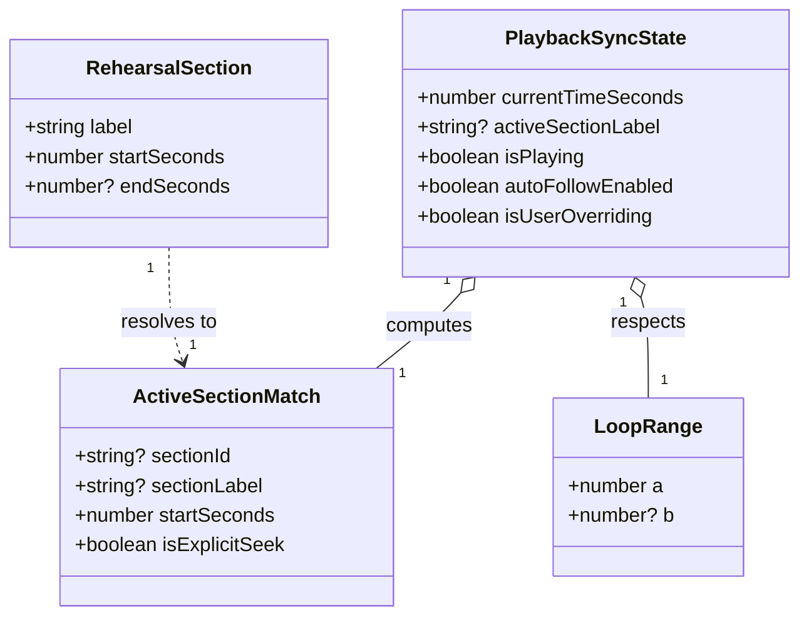
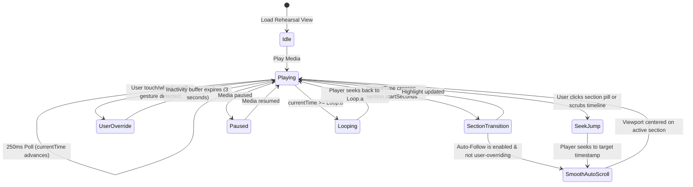

# Data Model: Rehearsal Live Playback Synchronization

**Feature Branch**: `003-rehearsal-live-sync` | **Date**: 2026-11-11

---

## 1. Core Domain Types & Entities

### 1.1 `RehearsalSection` (Domain Value Object)

Represents a configured arrangement timestamp marker within a song.

| Field          | Type      | Description                                                             | Constraints                        |
| :------------- | :-------- | :---------------------------------------------------------------------- | :--------------------------------- |
| `label`        | `string`  | Section identifier matching ChordPro header (e.g., "Verse 1", "Chorus") | Non-empty, max 50 chars            |
| `startSeconds` | `number`  | Playback position where this section begins in seconds                  | $\ge 0$, integer or float          |
| `endSeconds`   | `number?` | Optional boundary where section concludes                               | Optional, must be $> startSeconds$ |

### 1.2 `PlaybackSyncState` (Transient Presentation State)

Represents the real-time client synchronization state managed during rehearsal playback.

| Field                | Type      | Description                                              | Default |
| :------------------- | :-------- | :------------------------------------------------------- | :------ |
| `currentTimeSeconds` | `number`  | Latest timestamp reported by the media player            | `0`     |
| `activeSectionLabel` | `string?` | Label of the currently playing section                   | `null`  |
| `isPlaying`          | `boolean` | Whether media is actively progressing                    | `false` |
| `autoFollowEnabled`  | `boolean` | Musician preference for automatic viewport scrolling     | `true`  |
| `isUserOverriding`   | `boolean` | Whether manual user scroll gesture is temporarily active | `false` |

---

## 2. State Machine & Transitions

---

## 3. Validation Rules

- **Timestamp Monotonicity**: While section timestamps are typically defined in sequential order, the matching algorithm must canonically sort by `startSeconds ASC` prior to range evaluation to prevent misbehavior if timestamps were entered out of order.
- **Negative Timestamps**: Timestamps $< 0$ are invalid and treated as `0`.
- **Duplicate Labels**: If multiple sections share the identical label (e.g. repeated "Chorus"), the resolution returns the specific section occurrence matching the active time window, distinguishing occurrences by index or ID anchor.
