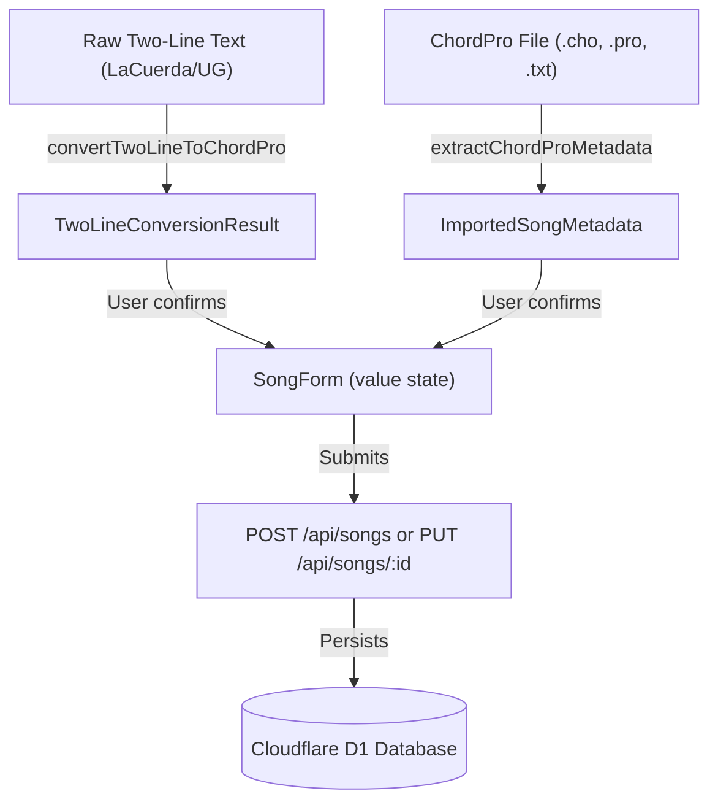

# Data Model: Smart ChordPro Importer & Two-Line Chord Text Converter

**Feature**: `004-chord-smart-importer`
**Date**: 2026-11-11
**Status**: Completed

## 1. Pure Domain Entities & Types (`src/core/domain/chord-converter.ts`)

### `ChordToken`

Represents an isolated musical chord recognized on a chord line.
```typescript
export interface ChordToken {
  /** The musical chord string, e.g. "G", "D/F#", "Em7", "Cadd9" */
  readonly chord: string;
  /** 0-based column index where the chord started on the original line */
  readonly columnIndex: number;
}
```

### `TwoLineConversionResult`

The deterministic output from converting raw two-line text into ChordPro format.
```typescript
export interface TwoLineConversionResult {
  /** The resulting ChordPro formatted text with [Chords] inline */
  readonly chordProText: string;
  /** Automatically detected rehearsal section timestamps */
  readonly extractedTimestamps: readonly SectionTimestamp[];
  /** Inferred musical key based on predominant chords/tonic, or null */
  readonly detectedKey: string | null;
  /** Total lines processed */
  readonly lineCount: number;
  /** Total unique chords detected */
  readonly chordsCount: number;
  /** Helpful warnings or notifications (e.g. suspicious chord formats) */
  readonly warnings: readonly string[];
}
```

### `ImportedSongMetadata`

Parsed metadata from `.chordpro`, `.cho`, or `.txt` files containing directives.
```typescript
export interface ImportedSongMetadata {
  readonly title?: string;
  readonly artist?: string;
  readonly originalKey?: string;
  readonly bpm?: number;
  readonly timeSignature?: string;
  readonly lyricsAndChords: string;
  readonly sectionTimestamps: readonly SectionTimestamp[];
}
```

---

## 2. Presentation Layer Contracts & State

### `SmartPasteModalProps`

Props for the interactive conversion modal.
```typescript
export interface SmartPasteModalProps {
  readonly isOpen: boolean;
  readonly onClose: () => void;
  readonly onApply: (result: {
    chordProText: string;
    sectionTimestamps?: readonly SectionTimestamp[];
    detectedKey?: string;
  }) => void;
  readonly currentKey?: string;
}
```

### `FileDropzoneProps`

Props for the drag-and-drop file upload target.
```typescript
export interface FileDropzoneProps {
  readonly onFileImported: (metadata: ImportedSongMetadata) => void;
  readonly disabled?: boolean;
  readonly hasExistingContent?: boolean;
}
```

---

## 3. Relationships & Data Flow


