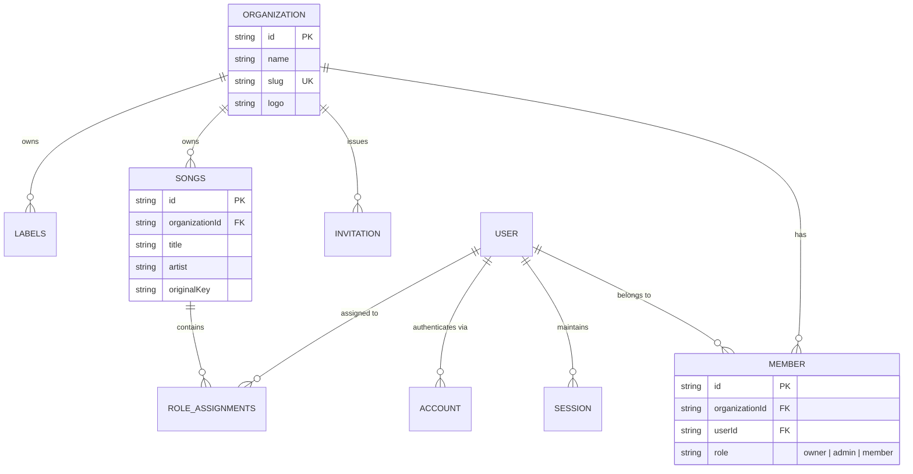

# Data Model: Better Auth & Multi-Tenant Organization Integration

**Feature**: `005-better-auth-integration`
**Date**: 2026-11-11
**Status**: Completed

## 1. Better Auth & Multi-Tenant Database Schema (`src/infrastructure/db/schema.ts`)

```typescript
import { integer, sqliteTable, text } from "drizzle-orm/sqlite-core";

// 1. Core User Table
export const user = sqliteTable("user", {
  id: text("id").primaryKey(),
  name: text("name").notNull(),
  email: text("email").notNull().unique(),
  emailVerified: integer("email_verified", { mode: "boolean" })
    .notNull()
    .default(false),
  image: text("image"),
  role: text("role").notNull().default("MEMBER"), // Global role: ADMIN | MEMBER
  createdAt: text("created_at").notNull(),
  updatedAt: text("updated_at").notNull(),
});

// 2. Active Sessions Table (with activeOrganizationId)
export const session = sqliteTable("session", {
  id: text("id").primaryKey(),
  userId: text("user_id")
    .notNull()
    .references(() => user.id, { onDelete: "cascade" }),
  token: text("token").notNull().unique(),
  expiresAt: text("expires_at").notNull(),
  ipAddress: text("ip_address"),
  userAgent: text("user_agent"),
  activeOrganizationId: text("active_organization_id"),
  createdAt: text("created_at").notNull(),
  updatedAt: text("updated_at").notNull(),
});

// 3. Accounts (Credentials & OAuth)
export const account = sqliteTable("account", {
  id: text("id").primaryKey(),
  userId: text("user_id")
    .notNull()
    .references(() => user.id, { onDelete: "cascade" }),
  accountId: text("account_id").notNull(),
  providerId: text("provider_id").notNull(),
  accessToken: text("access_token"),
  refreshToken: text("refresh_token"),
  idToken: text("id_token"),
  accessTokenExpiresAt: text("access_token_expires_at"),
  refreshTokenExpiresAt: text("refresh_token_expires_at"),
  scope: text("scope"),
  password: text("password"), // Hashed password for email/password credentials
  createdAt: text("created_at").notNull(),
  updatedAt: text("updated_at").notNull(),
});

// 4. Verifications
export const verification = sqliteTable("verification", {
  id: text("id").primaryKey(),
  identifier: text("identifier").notNull(),
  value: text("value").notNull(),
  expiresAt: text("expires_at").notNull(),
  createdAt: text("created_at").notNull(),
  updatedAt: text("updated_at").notNull(),
});

// 5. Organizations (Churches, Campuses, Ministries)
export const organization = sqliteTable("organization", {
  id: text("id").primaryKey(),
  name: text("name").notNull(),
  slug: text("slug").notNull().unique(),
  logo: text("logo"),
  createdAt: text("created_at").notNull(),
  metadata: text("metadata"),
});

// 6. Organization Members (User Membership & Org Roles)
export const member = sqliteTable("member", {
  id: text("id").primaryKey(),
  organizationId: text("organization_id")
    .notNull()
    .references(() => organization.id, { onDelete: "cascade" }),
  userId: text("user_id")
    .notNull()
    .references(() => user.id, { onDelete: "cascade" }),
  role: text("role").notNull().default("member"), // owner | admin | member
  createdAt: text("created_at").notNull(),
});

// 7. Organization Invitations
export const invitation = sqliteTable("invitation", {
  id: text("id").primaryKey(),
  organizationId: text("organization_id")
    .notNull()
    .references(() => organization.id, { onDelete: "cascade" }),
  email: text("email").notNull(),
  role: text("role").notNull().default("member"),
  status: text("status").notNull().default("pending"), // pending | accepted | rejected | canceled
  expiresAt: text("expires_at").notNull(),
  inviterId: text("inviter_id")
    .notNull()
    .references(() => user.id, { onDelete: "cascade" }),
  createdAt: text("created_at").notNull(),
});

// 8. Songs Scoped to Organization
export const songs = sqliteTable("songs", {
  id: text("id").primaryKey(),
  organizationId: text("organization_id")
    .notNull()
    .references(() => organization.id, { onDelete: "cascade" }),
  title: text("title").notNull(),
  artist: text("artist").notNull(),
  originalKey: text("original_key").notNull(),
  practiceKey: text("practice_key"),
  bpm: integer("bpm"),
  timeSignature: text("time_signature"),
  lyricsAndChords: text("lyrics_and_chords").notNull().default(""),
  youtubeVideoId: text("youtube_video_id"),
  sectionTimestamps: text("section_timestamps").notNull().default("[]"),
  createdAt: text("created_at").notNull(),
  updatedAt: text("updated_at").notNull(),
});

// 9. Labels Scoped to Organization
export const labels = sqliteTable("labels", {
  id: text("id").primaryKey(),
  organizationId: text("organization_id")
    .notNull()
    .references(() => organization.id, { onDelete: "cascade" }),
  name: text("name").notNull(),
  slug: text("slug").notNull(),
  colorHex: text("color_hex").notNull().default("#6366f1"),
  createdAt: text("created_at").notNull(),
  updatedAt: text("updated_at").notNull(),
});
```

---

## 2. Entity Relationships & Multi-Tenancy Boundary


