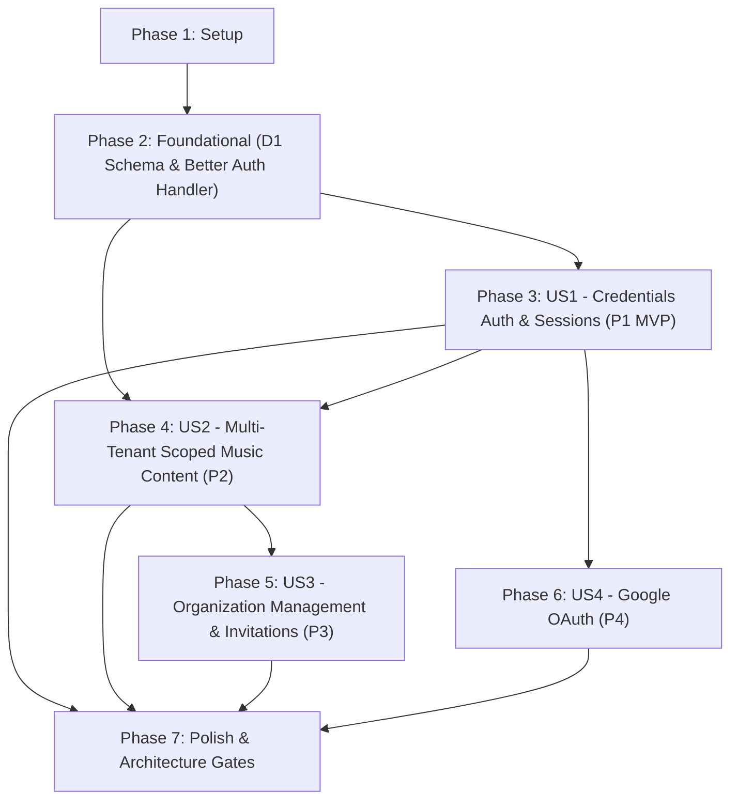

# Tasks: Better Auth Authentication & Multi-Tenant Organization Integration

**Input**: Design documents from `/specs/005-better-auth-integration/`
**Prerequisites**: [plan.md](file:///home/gustadev121/Workspace/Non-Profit/cjn/worship/specs/005-better-auth-integration/plan.md), [spec.md](file:///home/gustadev121/Workspace/Non-Profit/cjn/worship/specs/005-better-auth-integration/spec.md), [data-model.md](file:///home/gustadev121/Workspace/Non-Profit/cjn/worship/specs/005-better-auth-integration/data-model.md), [research.md](file:///home/gustadev121/Workspace/Non-Profit/cjn/worship/specs/005-better-auth-integration/research.md), [contracts/auth-and-organization.md](file:///home/gustadev121/Workspace/Non-Profit/cjn/worship/specs/005-better-auth-integration/contracts/auth-and-organization.md)
**Constitution**: [.specify/memory/constitution.md](file:///home/gustadev121/Workspace/Non-Profit/cjn/worship/.specify/memory/constitution.md)

## Format: `[ID] [P?] [Story] Description`

- **[P]**: Can run in parallel (different files, no dependencies on incomplete tasks)
- **[Story]**: Which user story this task belongs to (e.g., US1, US2, US3, US4)
- Descriptions include exact file paths and quoted schema constraints from data-model.md

## Path Conventions

- Single project Clean Architecture layout:
  - Pure domain: `src/core/domain/` (0 external dependencies)
  - Application layer: `src/core/application/` (ports, schemas, use cases)
  - Infrastructure: `src/infrastructure/` (Drizzle, D1, Better Auth)
  - Presentation / App Router: `src/app/`, `src/presentation/`
  - Tests: `tests/unit/`, `tests/integration/`

---

## Phase 1: Setup (Shared Infrastructure)

**Purpose**: Dependency installation and core pure domain models

- [ ] T001 Install `better-auth` dependency in package.json and run `bun install`
- [ ] T002 [P] Create pure domain Organization and Member entities, types, and validators (`Organization`, `OrganizationMember`, `OrganizationInvitation`, `OrganizationRole: "owner" | "admin" | "member"`, `InvitationStatus: "pending" | "accepted" | "rejected" | "canceled"`) with 0 external imports in src/core/domain/organization.ts
- [ ] T003 [P] Add `organizationId: string` field with non-empty validation to `Song` and `Label` domain models in src/core/domain/song.ts and src/core/domain/label.ts
- [ ] T004 [P] Extend `SessionPayload` (`sub`, `username`, `email`, `role: "ADMIN" | "MEMBER"`, `activeOrganizationId: string | null`, `organizationRole: "owner" | "admin" | "member" | null`) and `SongFilter` (`organizationId?: string`) in src/core/application/ports.ts
- [ ] T005 [P] Create Zod schemas for organization operations (`createOrganizationSchema`, `inviteMemberSchema`, `setActiveOrgSchema`) in src/core/application/schemas.ts

---

## Phase 2: Foundational (Blocking Prerequisites)

**Purpose**: Core D1 database schema, migrations, Better Auth server factory, and universal handler route

**⚠️ CRITICAL**: No user story work can begin until this phase is complete

- [ ] T006 Create D1 raw migration SQL script in drizzle/0003_better_auth.sql defining `user`, `session`, `account`, `verification`, `organization`, `member`, `invitation` tables and adding `organization_id` foreign key columns to `songs` and `labels`
- [ ] T007 Update Drizzle ORM schema in src/infrastructure/db/schema.ts defining `user` (`role: text("role").notNull().default("MEMBER")`, `emailVerified: integer("email_verified", { mode: "boolean" }).notNull().default(false)`), `session` (`activeOrganizationId: text("active_organization_id")`, `userId` cascade delete), `account` (`password: text("password")`), `verification`, `organization` (`slug: text("slug").notNull().unique()`), `member` (`role: text("role").notNull().default("member")`), `invitation` (`status: text("status").notNull().default("pending")`, `role: text("role").notNull().default("member")`), and adding `organizationId: text("organization_id").notNull().references(() => organization.id, { onDelete: "cascade" })` to `songs` and `labels`
- [ ] T008 Update D1 database client and migration runner in src/infrastructure/db/client.ts to import `drizzle/0003_better_auth.sql?raw` and execute table migrations idempotently
- [ ] T009 [P] Implement Better Auth server factory `getAuth(d1Binding, env)` in src/infrastructure/auth/better-auth.ts using Drizzle SQLite adapter and official `organization()` plugin
- [ ] T010 [P] Create client-side Better Auth SDK client instance `authClient` in src/infrastructure/auth/auth-client.ts using `createAuthClient` and `organizationClient()` plugin
- [ ] T011 Create universal Better Auth catch-all API route handler in src/app/api/auth/[...all]/route.ts dispatching all incoming requests to `getAuth(db, env).handler(req)`

**Checkpoint**: Foundation ready - Better Auth endpoints and D1 schema are live. User stories can proceed.

---

## Phase 3: User Story 1 - Credentials Authentication & Unified Session Management (Priority: P1) 🎯 MVP

**Goal**: Worship leaders and team members sign in securely with email/password credentials via Better Auth; active sessions are verified on D1; RBAC (`ADMIN` vs `MEMBER`) is enforced across protected routes.

**Independent Test**: Seed an admin user; perform sign-in via `/api/auth/sign-in/email`; verify that a valid session token is recorded in D1 `session` table; verify protected routes (`/`, `/songs/new`, `/admin/*`) authenticate and enforce role permissions.

### Tests for User Story 1

- [ ] T012 [P] [US1] Create integration tests for credentials signup, login, session token validation, and logout in tests/integration/auth-better-auth.test.ts

### Implementation for User Story 1

- [ ] T013 [US1] Refactor server session resolver `getSession()` in src/presentation/auth.ts to verify sessions using `getAuth(db, env).api.getSession({ headers })` and return standard `SessionPayload`
- [ ] T014 [US1] Adapt DI container in src/infrastructure/container.ts to support Better Auth session resolution while maintaining backward compatibility for service boundaries
- [ ] T015 [US1] Update login page in src/app/login/page.tsx to use `authClient.signIn.email` with input validation, error handling, loading states, and redirect to `/`
- [ ] T016 [US1] Update logout action in src/presentation/components/layout/navbar.tsx and src/presentation/components/layout/mobile-dock.tsx using `authClient.signOut` to revoke session
- [ ] T017 [US1] Enforce role-based access control (`ADMIN` vs `MEMBER`) from Better Auth session in protected pages src/app/admin/users/page.tsx, src/app/admin/labels/page.tsx, and src/app/songs/new/page.tsx

**Checkpoint**: User Story 1 MVP complete. Users can authenticate, maintain sessions in D1, and have roles enforced.

---

## Phase 4: User Story 2 - Multi-Tenant Organization Support & Scoped Music Content (Priority: P2)

**Goal**: Scope songs, chord sheets, labels, and rehearsal role assignments strictly to the active organization (`organizationId`). Provide Organization Switcher UI in header. Block cross-tenant access.

**Independent Test**: Create two organizations (Org A and Org B); add songs in Org A; switch active organization to Org B; verify Org B has empty catalog; verify cross-tenant access to Org A song ID returns 404 or 403.

### Tests for User Story 2

- [ ] T018 [P] [US2] Create integration tests for multi-tenant song isolation and organization switching in tests/integration/auth-organization.test.ts

### Implementation for User Story 2

- [ ] T019 [US2] Update `DrizzleSongRepository` in src/infrastructure/repositories/DrizzleSongRepository.ts to strictly filter by `organizationId` in `list()`, `findById()`, and require `organizationId` in `create()`
- [ ] T020 [US2] Update `DrizzleLabelRepository` in src/infrastructure/repositories/DrizzleLabelRepository.ts to filter and persist labels by `organizationId`
- [ ] T021 [US2] Update song application use cases in src/core/application/use-cases/songs.ts to accept and enforce `organizationId` tenant isolation
- [ ] T022 [US2] Update label application use cases in src/core/application/use-cases/labels.ts to accept and enforce `organizationId` tenant isolation
- [ ] T023 [US2] Update song and label API routes in src/app/api/songs/route.ts, src/app/api/songs/[id]/route.ts, and src/app/api/labels/route.ts to extract `activeOrganizationId` from session
- [ ] T024 [US2] Create `OrganizationSwitcher` dropdown component in src/presentation/components/layout/organization-switcher.tsx supporting active org selection via `authClient.organization.setActive` and modal trigger
- [ ] T025 [US2] Integrate `OrganizationSwitcher` into navigation bar in src/presentation/components/layout/navbar.tsx and mobile drawer in src/presentation/components/layout/more-drawer.tsx
- [ ] T026 [US2] Update catalog page in src/app/page.tsx and song creation form in src/app/songs/new/form.tsx to pass `activeOrganizationId` to queries and mutations

**Checkpoint**: User Story 2 complete. Music catalog and labels are isolated per organization. Switcher updates active context seamlessly.

---

## Phase 5: User Story 3 - Organization Management & Member Invitations (Priority: P3)

**Goal**: Church and worship leaders can create new organizations, invite members by email with assigned roles (`owner`, `admin`, `member`), and accept pending invitations.

**Independent Test**: As an org admin, send an invite to an email address; verify an invitation record is created in D1 `invitation` table with status `"pending"`; accept invite; verify user joins the organization with assigned role.

### Tests for User Story 3

- [ ] T027 [P] [US3] Create integration tests for organization creation, invitations, and membership acceptance in tests/integration/organization-management.test.ts

### Implementation for User Story 3

- [ ] T028 [US3] Define `IOrganizationRepository` port in src/core/application/ports.ts and implement `DrizzleOrganizationRepository` in src/infrastructure/repositories/DrizzleOrganizationRepository.ts
- [ ] T029 [US3] Implement organization use cases (`CreateOrganizationUseCase`, `ListUserOrganizationsUseCase`, `InviteMemberUseCase`, `AcceptInvitationUseCase`) in src/core/application/use-cases/organizations.ts
- [ ] T030 [US3] Create organization creation and member invitation modal in src/presentation/components/organization/organization-modal.tsx
- [ ] T031 [US3] Create organization administration view in src/app/admin/organization/page.tsx for managing church campuses, team members, and invitation statuses

**Checkpoint**: User Story 3 complete. Full organization provisioning and invitation lifecycle functional.

---

## Phase 6: User Story 4 - Google OAuth & Social Authentication (Priority: P4)

**Goal**: Worship team volunteers can sign in with their Google account in 1 click, linking accounts by email without duplicates.

**Independent Test**: Trigger Google OAuth sign-in button; verify redirect to Google provider; verify session created in `session` table with linked `account` record.

### Implementation for User Story 4

- [ ] T032 [US4] Configure Google OAuth provider in Better Auth server factory in src/infrastructure/auth/better-auth.ts using `env.GOOGLE_CLIENT_ID` and `env.GOOGLE_CLIENT_SECRET`
- [ ] T033 [US4] Add "Continuar con Google" button in src/app/login/page.tsx calling `authClient.signIn.social({ provider: "google" })`

**Checkpoint**: User Story 4 complete. Social authentication functional.

---

## Phase 7: Polish & Cross-Cutting Concerns

**Purpose**: Update seeds, migrate existing test fixtures to include `organizationId`, and verify all architectural gates

- [ ] T034 Update database seed script in scripts/seed.ts to provision default organization `"WorshipFlow Central"` (`slug: "worshipflow-central"`), default admin/member users, and link all seed songs and labels to this organization
- [ ] T035 Update existing unit and integration test fixtures in tests/integration/repositories.test.ts and tests/unit/application/use-cases.test.ts with valid `organizationId`
- [ ] T036 Run automated quality and architecture gates (`bun run check:arch`, `bun run check`, `bun test`, `bun run build`) and verify 100% pass rate

---

## Dependencies & Execution Order

### Phase Dependencies

- **Setup (Phase 1)**: No dependencies - can start immediately.
- **Foundational (Phase 2)**: Depends on Phase 1 completion - **BLOCKS** all user stories.
- **User Story 1 (Phase 3)**: Depends on Phase 2 completion - MVP milestone.
- **User Story 2 (Phase 4)**: Depends on Phase 2 completion and User Story 1 session resolution.
- **User Story 3 (Phase 5)**: Depends on Phase 2 completion and User Story 1/2 org foundation.
- **User Story 4 (Phase 6)**: Depends on Phase 3 Better Auth handler completion.
- **Polish (Phase 7)**: Depends on all user stories being complete.

### User Story Dependencies



### Parallel Opportunities

- **Phase 1**: T002, T003, T004, T005 can all execute in parallel across domain and application files.
- **Phase 2**: T009 and T010 can execute in parallel while database migrations (T006, T007, T008) are prepared.
- **Phase 3**: T012 test writing can run in parallel before implementation tasks.
- **Phase 4**: T018 test writing and T024 UI component development can run in parallel with repository updates.
- **Phase 5**: T027 test writing can run in parallel with application use cases.

---

## Parallel Example: User Story 1

```bash
# Launch test task and UI adjustments in parallel:
Task: "Create integration tests for credentials signup, login, session token validation, and logout in tests/integration/auth-better-auth.test.ts"
Task: "Update login page in src/app/login/page.tsx to use authClient.signIn.email with input validation, error handling, loading states, and redirect to /"
```

---

## Implementation Strategy

### MVP First (User Story 1 Only)

1. Complete Phase 1: Setup (T001-T005)
2. Complete Phase 2: Foundational (T006-T011) - **CRITICAL GATE**
3. Complete Phase 3: User Story 1 (T012-T017)
4. **STOP and VALIDATE**: Verify sign-in, session resolution, and RBAC via `bun test tests/integration/auth-better-auth.test.ts`.

### Incremental Delivery

1. Setup + Foundational → Database schema with Better Auth & Organization tables live.
2. User Story 1 → Better Auth credentials sign-in & unified sessions (MVP).
3. User Story 2 → Multi-tenant songs & labels partitioned by `organizationId`, Organization Switcher in navbar.
4. User Story 3 → Organization creation, member invitations, and campus management.
5. User Story 4 → Google OAuth 1-click social sign-in.
6. Phase 7 Polish → Seeds updated, test fixtures updated, architecture gate `bun run check:arch` passes cleanly.

---

## Notes

- **[P]** marks tasks touching independent files with no incomplete prerequisites.
- **[Story]** label maps directly to user stories (`[US1]`, `[US2]`, `[US3]`, `[US4]`) from `spec.md`.
- Pure domain (`src/core/domain`) has 0 external dependencies as mandated by Constitution Principle I.
- Every task includes an exact file path and specific acceptance criteria.
